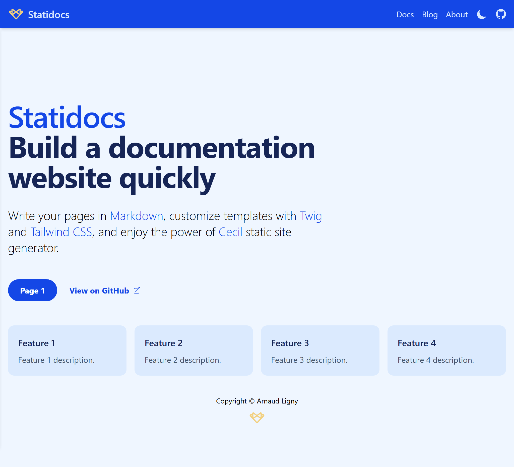

# Statidocs

Statidocs is a documentation starter site, built on top of [Cecil](https://cecil.app) and the [Docs theme](https://github.com/Cecilapp/theme-docs).

[](https://statidocs.cecil.app)

> [!IMPORTANT]  
> Statidocs is still in development. If something that’s not working, please [open an issue on GitHub](https://github.com/Cecilapp/statidocs/issues/new/choose).

## Install

The easiest way to create a new Statidocs project is using [Composer](https://getcomposer.org):

```bash
composer create-project cecil/statidocs --ask
```

[](https://packagist.org/packages/cecil/statidocs)

## Demo

- Hosted by GitHub Pages: <https://cecilapp.github.io/statidocs/>
- Hosted by Vercel: <https://statidocs.vercel.app>

## Usage

Build & preview:

```bash
php cecil.phar serve
```

Read the [documentation](https://statidocs.cecil.app).

### Update themes

Statidocs is depending of Cecil's themes [Docs](https://github.com/Cecilapp/theme-docs), [FlexSearch](https://github.com/Cecilapp/theme-flexsearch), [PWA](https://github.com/Cecilapp/theme-pwa), [Redirects](https://github.com/Cecilapp/theme-redirects) and [Headers](https://github.com/Cecilapp/theme-headers).

Use Composer to update them:

```bash
composer update
```

### Configuration

Open and edit the [`cecil.yml`](cecil.yml) file.

### Search

The search is provided by the [FlexSearch theme](https://github.com/Cecilapp/theme-flexsearch), enabled by default: the index is generated at build time, without any external service.

See the [FlexSearch theme configuration](https://github.com/Cecilapp/theme-flexsearch#configuration) to customize indexed sections and search options.

#### Use Algolia DocSearch instead

You can use [Algolia DocSearch](https://docsearch.algolia.com) instead, with the [DocSearch theme](https://github.com/Cecilapp/theme-docsearch):

1. Install the theme:

   ```bash
   composer require cecil/theme-docsearch
   ```

2. Replace `flexsearch` by `docsearch` in the `theme` section of the [`cecil.yml`](cecil.yml) file, and add your Algolia credentials:

   ```yaml
   theme:
     - docs
     - docsearch
     - pwa
     - redirects
     - headers
   docsearch:
     appId: <YOUR_APP_ID>
     apiKey: <YOUR_SEARCH_API_KEY> # search-only API key
     indexName: <YOUR_INDEX_NAME>
   ```

3. Optionally, uninstall the FlexSearch theme:

   ```bash
   composer remove cecil/theme-flexsearch
   ```

> [!NOTE]
> DocSearch requires an Algolia index of your website: [apply to the DocSearch program](https://docsearch.algolia.com/apply/) or [run your own crawler](https://www.algolia.com/doc/tools/crawler/getting-started/overview/).  
> See the [DocSearch theme configuration](https://github.com/Cecilapp/theme-docsearch#configuration) for other options.

## Publish

```bash
php cecil.phar build
```

Then copy content of `_site` to your web server.
